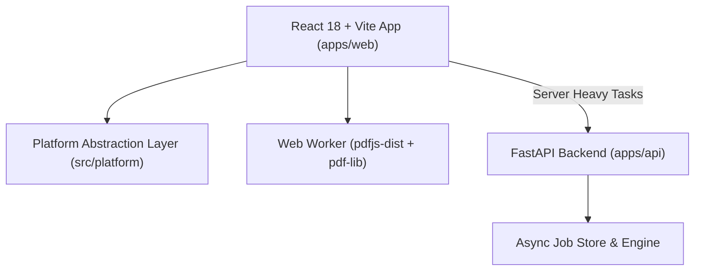

# Master_PDF

A premium, privacy-first, all-in-one PDF toolkit built with React 18, TypeScript, Tailwind CSS, and a high-performance Python FastAPI backend. Designed for seamless portability to Desktop (**Electron**) and Mobile (**Capacitor**).

---

## Key Features

- **Privacy-First & Local-First:** Core operations (merge, split, rotate, reorder, annotate, form fill, e-signatures, offline viewing) execute 100% inside your browser or native container using Web Workers and `pdf-lib`.
- **Advanced Backend Engine:** Async jobs for heavy OCR (OCRmyPDF/Tesseract), format conversions (LibreOffice, pdf2docx), certified digital signatures (`pyHanko`), and permanent byte-level redaction (`PyMuPDF`).
- **Platform Agnostic:** Built on top of a unified platform abstraction layer (`src/platform/`) with clean targets for Web, Electron, and Capacitor.
- **Modern UI & UX:** Command palette (`Ctrl+K`), drag-and-drop workspace, dark/light mode, and real-time processing badges ("Processed Locally" vs "Processed on Server").

---

## Architecture Overview



---

## Quick Start (under 5 commands)

```bash
# 1. Clone & Enter
cd Master_PDF

# 2. Install dependencies
npm install
cd apps/api && pip install -r requirements.txt && cd ../..

# 3. Start Frontend (Vite)
npm run dev

# 4. In a second terminal, start Backend (FastAPI)
npm run api:dev
```

Frontend runs at: `http://localhost:5173`  
Backend API runs at: `http://localhost:8000` (OpenAPI docs at `/docs`)

---

## Documentation

- [Project Specification](file:///D:/Personal_Project/Master_PDF/PROJECT_SPEC.md)
- [System Architecture](file:///D:/Personal_Project/Master_PDF/docs/ARCHITECTURE.md)
- [Phase-Based Execution Plan](file:///D:/Personal_Project/Master_PDF/docs/EXECUTION_PLAN.md)
- [Architecture Decisions (ADR)](file:///D:/Personal_Project/Master_PDF/docs/DECISIONS.md)
