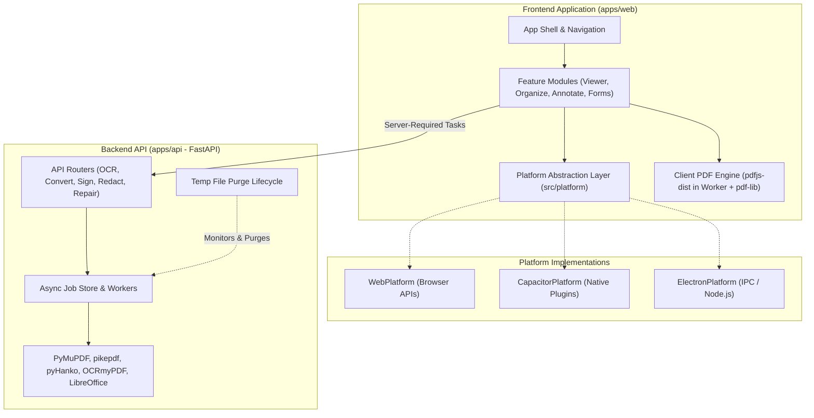

# Master_PDF System Architecture

## 1. Architectural Philosophy & Core Tenets

Master_PDF is designed as a **modern, privacy-first, client-heavy PDF suite**. It is architected from Day 1 to run on the Web and be seamlessly packaged into **Desktop (Electron)** and **Mobile (Capacitor)** applications without code rewrites.



### 1.1 Client-First Boundary
To maximize privacy, minimize server load, and enable offline usage:
- **Client Operations (Offline-capable)**:
  - Document viewing, zoom, text search, thumbnail rendering (`pdfjs-dist` in Web Workers).
  - Page organization: merge, split, reorder, rotate, delete, extract (`pdf-lib`).
  - Annotations, vector drawing, stamps, highlights.
  - Interactive AcroForm filling and flattening.
  - Image to PDF, PDF to Images rendering.
  - E-Signature drawing and image placement.
- **Server Operations (FastAPI Backend)**:
  - Heavy OCR with multi-language layout detection (`OCRmyPDF` + `Tesseract`).
  - Format conversions (Office to PDF via headless LibreOffice, PDF to Word/Excel/Markdown).
  - Certified PKCS#12 digital signatures and timestamping (`pyHanko`).
  - True byte-level redaction (`PyMuPDF`) with content verification.
  - Advanced PDF compression presets and PDF/A conversion (`Ghostscript`, `pikepdf`).

---

## 2. Platform Abstraction Layer (`apps/web/src/platform/`)

Feature code **never** directly accesses browser-specific APIs (such as `window.showOpenFilePicker`, `localStorage`, or `navigator.clipboard`). All environment interactions pass through uniform interfaces:

```typescript
// FileService Interface
export interface PlatformFile {
  name: string;
  size: number;
  type: string;
  data: Uint8Array | Blob;
}

export interface FileService {
  openFile(options?: { accept?: string[]; multiple?: boolean }): Promise<PlatformFile[]>;
  saveFile(blob: Blob, defaultName: string): Promise<void>;
  shareFile(file: PlatformFile): Promise<void>;
}

// StorageService Interface
export interface StorageService {
  getItem<T>(key: string): Promise<T | null>;
  setItem<T>(key: string, value: T): Promise<void>;
  removeItem(key: string): Promise<void>;
}

// ClipboardService Interface
export interface ClipboardService {
  writeText(text: string): Promise<void>;
  readText(): Promise<string>;
}

// NetworkService Interface
export interface NetworkService {
  isOnline(): boolean;
  getApiBaseUrl(): string;
  setApiBaseUrl(url: string): void;
}
```

### Implementation Variants:
1. **`WebPlatform`** (Initial): Uses standard File System Access API / `<input type="file">`, IndexedDB / localStorage, and `navigator.clipboard`.
2. **`CapacitorPlatform`** (Mobile target): Maps to `@capacitor/filesystem`, `@capacitor/preferences`, and native share sheets.
3. **`ElectronPlatform`** (Desktop target): Maps to Electron IPC (`dialog.showOpenDialog`, native file system, and spawns the FastAPI backend as a local sidecar).

---

## 3. Frontend Architecture (`apps/web`)

### Tech Stack
- **Framework**: React 18 with TypeScript in strict mode
- **Bundler**: Vite
- **Styling**: Tailwind CSS + shadcn/ui components + Lucide icons
- **State Management**:
  - `workspaceStore` (Zustand): active document, view configuration, active panels, history stack (undo/redo).
  - `toolStore` (Zustand): tool parameters, options, progress state.
  - TanStack Query: asynchronous server communication and job polling.
- **Rendering & Manipulation**:
  - `pdfjs-dist`: rendered inside dedicated Web Workers to prevent frame drops.
  - Virtualized list for handling documents with 500+ pages.
  - `pdf-lib`: in-memory manipulation using typed arrays (`Uint8Array`).

---

## 4. Backend Architecture (`apps/api`)

### Tech Stack
- **Framework**: FastAPI (Python 3.11+) with Pydantic v2
- **Server**: Uvicorn
- **Job Processing**: Non-blocking `BackgroundTasks` backed by an extensible in-memory `JobStore` (designed for future Redis/Celery swap).
- **Core Processing Engines**:
  - `PyMuPDF` (fitz): text/image extraction, page modifications, true redactions.
  - `pikepdf` (qpdf wrapper): encryption, linearization, metadata management.
  - `OCRmyPDF` + `Tesseract`: OCR processing.
  - `pyHanko`: cryptographic signatures and verification.
  - `pdf2docx` / `pdfplumber`: document format conversions.

### Temp File Lifecycle & Security
1. All uploads are validated via magic bytes (validating `%PDF-` signature).
2. Files are assigned a UUID and isolated in a sandboxed temp directory (`/tmp/master_pdf/jobs/{job_id}`).
3. A background cleanup worker (`app/core/cleanup.py`) periodically deletes files older than TTL (30 minutes default).
4. Download endpoints support immediate file purge upon retrieval.

---

## 5. Security & Privacy Model

- **No Unintended Telemetry or Storage**: Client-side operations do not transmit document data over the network.
- **Explicit Badging**: Every tool clearly informs the user via a UI badge whether an operation is executed **Locally (Offline)** or requires **Server Processing**.
- **Sanitized Execution**: All backend shell and subprocess invocations (LibreOffice, Ghostscript) use strict argument arrays with no shell interpolation.
